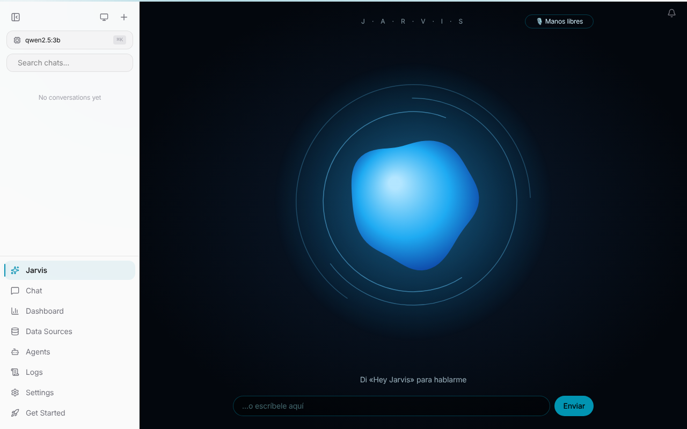

# Jarvis — tu asistente con orbe animado (100 % gratis)

Esto instala [OpenJarvis](https://github.com/open-jarvis/OpenJarvis) en tu ordenador con una pestaña
**Jarvis** propia: un orbe que respira, se mueve cuando le hablas y vibra mientras te responde en voz alta.

Funciona **sin pagar nada**: el "cerebro" es un modelo local (`qwen2.5:3b`) que corre en tu ordenador
con [Ollama]. No hace falta ninguna clave de API.



## Qué necesitas

- **Node.js 22 o más nuevo** → https://nodejs.org (botón "LTS")
- **git**
- Unos **5 GB libres** y 8 GB de RAM recomendados
- **Windows:** instala WSL2 primero (abre PowerShell como administrador y ejecuta `wsl --install`,
  reinicia, y haz el resto dentro de la ventana de "Ubuntu").
- **Mac:** instala antes Ollama desde https://ollama.com/download y ábrelo una vez.

## Instalar (una sola vez)

```bash
git clone -b ccr-f5800559-bf9129 https://github.com/marco8500/juniors.git
cd juniors/jarvis
bash instalar.sh
```

Tarda unos minutos (descarga ~2 GB del modelo). Al terminar se abre el navegador: entra en **Jarvis**
en el menú de la izquierda.

## Abrirlo otro día

```bash
bash juniors/jarvis/abrir.sh
```

## Cómo se usa

**Manos libres:** al abrir la pestaña, Jarvis se queda escuchando. Di **«Hey Jarvis»** (u «Oye Jarvis»)
seguido de lo que quieras, por ejemplo: *«Hey Jarvis, cuéntame un chiste»*. La primera vez el navegador
te pedirá permiso para el micrófono. Puedes apagarlo con el botón **🎙️ Manos libres**.

| Acción | Qué hace el orbe |
|---|---|
| Dices «Hey Jarvis…» (o pulsas el orbe) | Azul claro, crece con tu voz |
| Suelta / te callas | Morado: está pensando |
| Te responde en voz alta | Turquesa, vibra con cada palabra |
| Pulsa otra vez mientras habla | Lo interrumpe |

También puedes escribirle en el cuadro de abajo. El micrófono y la voz usan las funciones del
navegador: **usa Chrome o Edge**.

## Archivos

- `instalar.sh` — instala todo (OpenJarvis, la pestaña, Ollama, el modelo y la configuración)
- `abrir.sh` — lo vuelve a abrir
- `jarvis-tab.patch` — el código de la pestaña Jarvis (orbe + voz)

¿Quieres un modelo más listo? Si tu ordenador tiene 16 GB de RAM o más:
`MODELO=qwen2.5:7b bash instalar.sh`

[Ollama]: https://ollama.com
